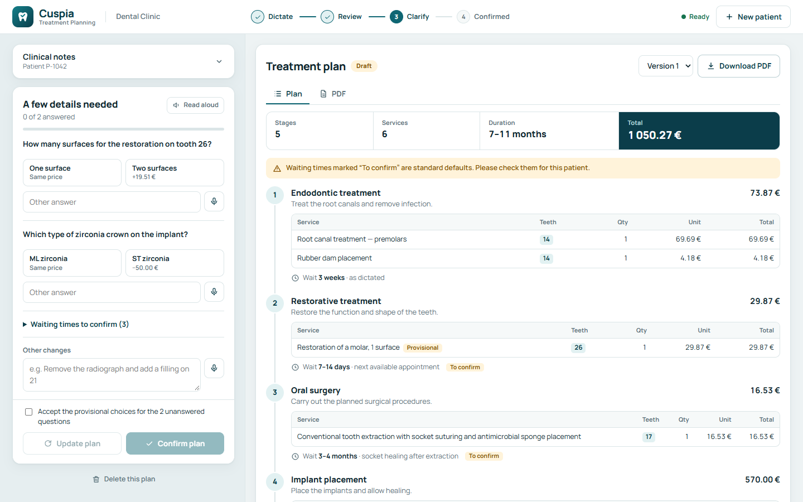

# Cuspia · Treatment Planning

An assistant for dental clinics. A dentist dictates the treatment. The assistant builds a **treatment plan** with stages, intervals and prices from the clinic price list, returns a **PDF**, **asks about anything unclear**, and **regenerates the PDF** until the dentist confirms it.

**Everything runs on your computer.** Speech-to-text (faster-whisper) and the AI (Ollama) are local, so audio, notes and plans never leave the machine. After the models are downloaded, no internet connection is needed.



## How it works

1. **Dictate** with the microphone, or type or paste notes.
2. **Check** the transcript and correct any word.
3. **Build the plan.** The local AI reads the dictation, code matches each procedure to the price list and computes every price.
4. **Answer the questions** (implant system, crown type, surfaces, wisdom-tooth grade…) by click, text or voice, and add any correction in plain English.
5. **Regenerate** the PDF. The screen shows what changed and the new total.
6. **Confirm.** The final PDF has no DRAFT watermark and has signature lines.

The AI never writes a price: prices come only from `data/catalog.json`, which is built from the clinic's Excel file.

## Requirements

- Windows 10 or 11 (other systems should work with adapted commands)
- Python 3.12
- Node.js 20 or newer
- [Ollama](https://ollama.com)
- About 8 GB of RAM and 4 GB of free disk space

## Setup

Run these commands from the project folder. The commands use the conda environment in `.venv/`; if you create your own environment, replace `.venv/python.exe` with `python`.

```bash
# 1. Python dependencies
.venv/python.exe -m pip install -r backend/requirements.txt

# 2. Local AI model
ollama pull qwen3:4b

# 3. Configuration (optional: clinic name, address, dentist)
cp .env.example .env

# 4. Frontend dependencies
cd frontend
npm install
cd ..
```

The Whisper speech model (about 480 MB) downloads automatically to `storage/models/` the first time you transcribe a recording.

## Run

Make sure the Ollama app is running, then open two terminals in the project folder.

```bash
# Terminal 1: backend, http://localhost:8000/docs
.venv/python.exe -m uvicorn app.main:app --app-dir backend --port 8000

# Terminal 2: interface
cd frontend
npm run dev
```

Open **http://localhost:5173**. The status at the top right should say **Ready**.

## Public link

The app is published at **https://cuspia.dmb-site.site** through a Cloudflare Tunnel that runs on this PC.

**To use it:** open the link, choose **Create account**, enter your name, email and a password of at least 8 characters. Each user sees only their own plans, and can reopen, continue, download or delete them from **My plans**. Passwords are stored as salted scrypt hashes, in `storage/users.json`, which is never committed.

```powershell
# Put the link online. Keep this window open and the PC awake.
powershell -ExecutionPolicy Bypass -File scripts\start_public.ps1
```

Close the window or press Ctrl+C to take the link offline. The link only works while the PC is on, connected and running this script. Use synthetic notes only: this setup is not approved for real patient data.

## 3-minute demo

Use this dictation (speak it, or paste it):

> Patient has a fractured lower right first molar, tooth 46, it cannot be restored. First do a tooth extraction and socket preservation on 46. After healing, place an implant at 46 with a healing abutment. Then an abutment and a zirconia crown on the implant at 46.

1. **Understands voice:** click **Start dictation**, read the text, click **Stop**. The transcript appears.
2. **Generates a PDF:** click **Build treatment plan**. You get three stages and a draft PDF totalling **975.76 €**.
3. **Asks questions:** the assistant asks which implant system and which crown type, because the dentist did not say.
4. **Regenerates the PDF:** choose **Straumann** and **ST zirconia**, then click **Update plan**. The total becomes **1 356.53 €**, and the screen lists what changed.
5. **Confirms:** click **Confirm plan** and download the final PDF.

## Tests

```bash
# Unit and API tests: no Ollama, Whisper or network needed
.venv/python.exe -m pytest backend/tests

# Real local model on the practice notes (on demand)
.venv/python.exe backend/scripts/eval_samples.py --model qwen3:4b
```

## Limits to know

- **Not a clinical tool yet.** The default intervals in `backend/app/rules/clinic_rules.yaml` were written by the developers. They appear as assumptions until a dentist reviews the file and fills in `validated_by`.
- **The test notes are synthetic.** The instructor's sample notes were not available, so `data/sample_notes/` holds practice notes written for this project.
- **Check the transcript.** Speech recognition can mishear words (for example "two surface" as "tooth surface"), especially tooth numbers.
- **Some price-list entries look like duplicates.** For example, there are two different prices for a one-surface molar restoration. The assistant asks which one to use. See `data/catalog_report.md`.

## Project documents

- [SPEC.md](SPEC.md): task list and progress
- [ARCHITECTURE.md](ARCHITECTURE.md): technical design
- [docs/model_eval.md](docs/model_eval.md): local model results
- [CLAUDE.md](CLAUDE.md) and [AGENTS.md](AGENTS.md): rules for AI coding agents
